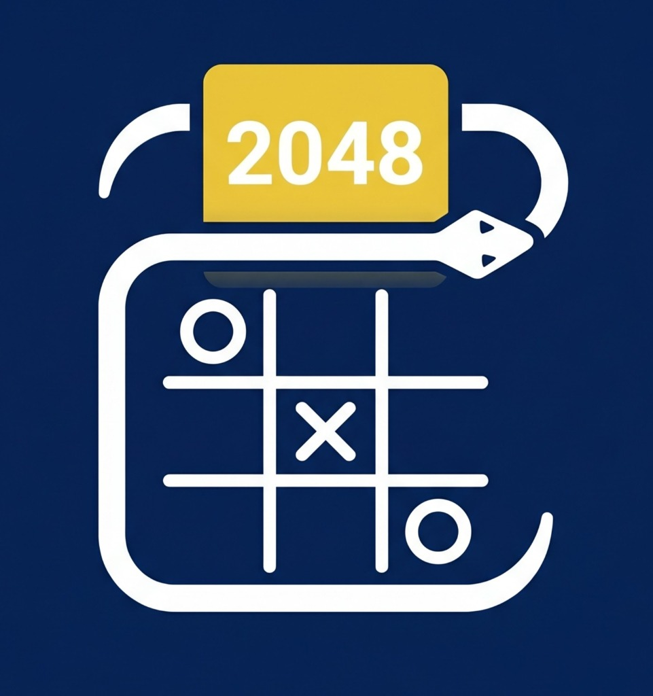
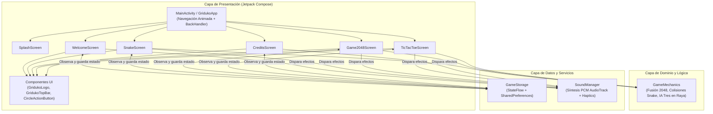

<div align="center">
  
  <h1>Griduko</h1>
  <p><strong>Colección Arcade Todo-en-Uno para Android: Snake · 2048 · Tres en Raya</strong></p>

  <p>
    
    
    
    
  </p>
</div>

---

## 📖 Descripción del Proyecto

**Griduko** es una aplicación móvil de juegos desarrollada nativamente en **Android Studio** utilizando **Kotlin** y **Jetpack Compose**. Reúne tres clásicos de cuadrícula (**Snake**, **2048** y **Tres en raya**) bajo una interfaz moderna en tonos azul marino y dorado, diseñada con transiciones fluidas, persistencia de estado en tiempo real entre vistas, efectos de sonido retro sintetizados por código y secretos ocultos (*Easter Eggs*).

---

## ✨ Características Principales

- **6 Pantallas Integradas**:
  1. **0 - Splash Screen**: Pantalla de bienvenida animada con barra de progreso e icono oficial.
  2. **1 - Menú Principal (Bienvenida)**: Selector interactivo de juegos con vista rápida de los récords actuales y acceso a créditos.
  3. **2 - Snake**: Tablero 15×15 con espera de preparación inicial (la serpiente aguarda el primer movimiento del jugador), controles duales (**gestos swipe** + **cruceta direccional D-Pad**), pausa y aumento progresivo de velocidad.
  4. **3 - 2048**: Tablero 4×4 con deslizamiento en 4 direcciones, animaciones *spring* al fusionar fichas, botón **Deshacer jugada** (*Undo*) y formato numérico de puntuaciones.
  5. **4 - Tres en Raya**: Tablero 3×3 con dos modos de juego (**`vs CPU`** con algoritmo táctico de bloqueo/victoria y **`2 jugadores`** local), marcador persistente de Victorias X, Empates y Victorias O, y resaltado de la línea ganadora.
  6. **5 - Créditos**: Tarjetas informativas personalizables (Desarrollo, Diseño, Juegos y Agradecimientos) con contador de secretos descubiertos.
- **Persistencia Total de Datos**:
  - Conserva tanto los **récords históricos** como el **estado exacto de la partida en curso** (posición de la serpiente, matriz actual de 2048, jugada anterior para deshacer, tablero y turno de Tres en raya) al cambiar de pantalla o cerrar la aplicación.
- **Motor de Audio Arcade Sintetizado (`SoundManager`)**:
  - Genera efectos de sonido estilo *chiptune / 8-bit* en tiempo real mediante ondas PCM (`AudioTrack`) en hilos secundarios, sin depender de archivos externos pesados, acompañado de **retroalimentación háptica**.
- **Easter Eggs Ocultos**:
  - 🕹️ **Código Konami en Snake**: Presionar la secuencia `▲ ▲ ▼ ▼ ◄ ► ◄ ►` en la cruceta D-Pad desbloquea el **Modo Serpiente Arcoíris**, otorga `+100 puntos` de bonificación y reproduce una fanfarria secreta.
  - ⭐ **Secreto del Logo**: Tocar **7 veces seguidas** el logotipo de Griduko en el menú principal activa el estandarte *Modo Arcade Secreto Desbloqueado* y el borde dorado especial.

---

## 🏗️ Arquitectura del Sistema

La aplicación sigue una arquitectura **Single-Activity + Unidirectional Data Flow (UDF)** basada en **Jetpack Compose** y flujos reactivos (`StateFlow`), separando claramente la interfaz de usuario, las reglas puras de los juegos, el almacenamiento persistente y la síntesis de audio.



### Detalle de las Capas
1. **Capa de Presentación (`ui/screens`, `ui/components`, `ui/theme`)**:
   - Cada pantalla es un `@Composable` desacoplado que recibe su estado inicial desde `StateFlow` y notifica eventos hacia `GameStorage` y `SoundManager`.
   - La transición entre pantallas se gestiona en `MainActivity` mediante `AnimatedContent` con animaciones combinadas de desplazamiento horizontal y fundido (`slide + fade`).
2. **Capa de Dominio (`GameMechanics`)**:
   - Contiene funciones puras y deterministas (sin dependencias de Android) para fusionar filas en **2048**, verificar líneas ganadoras y calcular movimientos óptimos de la **CPU en Tres en Raya**, facilitando las pruebas unitarias.
3. **Capa de Persistencia (`GameStorage`)**:
   - Serializa de forma ligera las estructuras de cada tablero (`SnakeSavedState`, `Game2048SavedState`, `TicTacToeSavedState`, `CreditsInfo`) en `SharedPreferences` y expone los cambios mediante `StateFlow` para mantener sincronizadas todas las vistas.
4. **Capa de Audio (`SoundManager`)**:
   - Construye buffers de audio PCM de 16 bits (`22050 Hz`) con envolventes de ataque y caída suaves sobre `Coroutines (Dispatchers.IO)` para reproducir acordes de victoria, fusión, comida y fin de partida sin bloquear el hilo principal de UI.

---

## 📂 Estructura del Proyecto

```text
Griduko/
├── app/
│   ├── build.gradle.kts
│   └── src/
│       ├── main/
│       │   ├── AndroidManifest.xml
│       │   ├── java/com/grid/griduko/
│       │   │   ├── MainActivity.kt                  # Punto de entrada y navegador de vistas
│       │   │   ├── audio/
│       │   │   │   └── SoundManager.kt              # Sintetizador de sonidos arcade PCM
│       │   │   ├── data/
│       │   │   │   └── GameStorage.kt               # Persistencia SharedPreferences + GameMechanics
│       │   │   └── ui/
│       │   │       ├── components/
│       │   │       │   ├── CircleActionButton.kt    # Botones circulares con iconos vectoriales en Canvas
│       │   │       │   ├── GridukoLogo.kt           # Componente del logo oficial y tarjetas de puntaje
│       │   │       │   └── GridukoTopBar.kt         # Barra superior con logo integrado junto al título
│       │   │       ├── screens/
│       │   │       │   ├── SplashScreen.kt          # 0 - Pantalla de carga inicial
│       │   │       │   ├── WelcomeScreen.kt         # 1 - Menú principal de selección de juego
│       │   │       │   ├── SnakeScreen.kt           # 2 - Juego Snake + D-Pad + Código Konami
│       │   │       │   ├── Game2048Screen.kt        # 3 - Juego 2048 + Deshacer jugada
│       │   │       │   ├── TicTacToeScreen.kt       # 4 - Juego Tres en raya (vs CPU / 2 Jugadores)
│       │   │       │   └── CreditsScreen.kt         # 5 - Pantalla de créditos editable
│       │   │       └── theme/
│       │   │           ├── Color.kt                 # Paleta de colores Navy, Dorado, Verde y Coral
│       │   │           ├── Theme.kt                 # Configuración de MaterialTheme oscuro
│       │   │           └── Type.kt                  # Definiciones tipográficas
│       │   └── res/
│       │       ├── drawable/
│       │       │   ├── logo_griduko.jpg             # Recurso gráfico oficial del logo
│       │       │   ├── ic_launcher_background.xml   # Fondo azul marino (#062252) del icono de Android
│       │       │   └── ic_launcher_foreground.xml   # Capa frontal del icono adaptativo
│       │       └── mipmap-anydpi/
│       │           ├── ic_launcher.xml              # Icono adaptativo estándar
│       │           └── ic_launcher_round.xml        # Icono adaptativo redondo
│       └── test/java/com/grid/griduko/
│           └── ExampleUnitTest.kt                   # Pruebas unitarias de lógica de los 3 juegos
├── gradle/
│   └── libs.versions.toml                           # Catálogo centralizado de versiones y dependencias
├── build.gradle.kts
└── settings.gradle.kts
```

---

## 🛠️ Tecnologías Utilizadas

| Tecnología | Uso en el Proyecto |
| :--- | :--- |
| **Kotlin 2.2** | Lenguaje principal de desarrollo, corrutinas y flujos reactivos (`StateFlow`). |
| **Jetpack Compose (Material 3)** | Construcción declarativa de las 6 pantallas, diálogos y componentes personalizados. |
| **Compose Canvas & Animations** | Trazado del tablero de Snake, iconos vectoriales centrados y animaciones *spring*. |
| **Android SharedPreferences** | Persistencia local inmediata de récords históricos y partidas en curso. |
| **Android AudioTrack (PCM)** | Síntesis de efectos de sonido retro en tiempo real sin activos externos. |
| **JUnit 4** | Pruebas unitarias de las reglas de negocio de Snake, 2048 y Tres en raya. |

---

## 🚀 Instalación y Ejecución

1. **Clonar el repositorio**:
   ```bash
   git clone https://github.com/tu-usuario/Griduko.git
   cd Griduko
   ```
2. **Abrir en Android Studio**:
   - Selecciona **Open** y elige la carpeta raíz `Griduko`.
   - Espera a que termine la sincronización de **Gradle**.
3. **Ejecutar en un dispositivo o emulador**:
   - Selecciona un emulador o dispositivo físico con **Android 8.0 (API 26)** o superior y presiona **Run (`Shift + F10`)**.
4. **Ejecutar las pruebas unitarias por consola**:
   ```bash
   ./gradlew testDebugUnitTest
   ```
